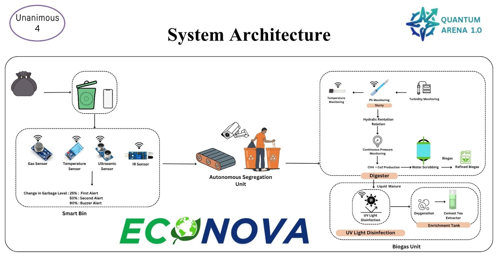

# 🏗️ EcoNova System Architecture & Data Flow

EcoNova is built as an end-to-end distributed Smart Waste Management platform integrating IoT edge devices, cloud telemetry, quantum-inspired optimization algorithms, and modern web visualization.

---

## 📐 High-Level Architecture Diagram

---

## 🧩 Architectural Layers

### 1. 📡 Edge & IoT Sensor Layer
- **Microcontroller:** ESP32 DevKit V1 operating over IEEE 802.11 b/g/n Wi-Fi.
- **Sensors:**
  - **HC-SR04 Ultrasonic Distance Sensor:** Triggered every 10 seconds to calculate bin fill volume via time-of-flight acoustic pulses.
  - **DHT11 Environmental Sensor:** Monitors internal bin temperature and humidity to detect hazardous conditions (e.g. decomposition heat or potential fire risks).
- **Firmware:** Written in C++/Arduino (`hardware/esp32_firmware.ino`), pushing JSON payloads over TLS directly to the cloud.

### 2. ☁️ Real-Time Telemetry & Cloud Storage
- **Firebase Realtime Database:** Ingests live telemetry streams from physical IoT hardware at low latency (`< 150ms`).
- **MongoDB Atlas:** Stores relational user profiles, administrator credentials, and audit logs.
- **REST & Serverless APIs:** Express.js Node backend and Netlify functions handle authentication and session authorization.

### 3. ⚛️ Quantum-Inspired Route Optimization Engine
- **Algorithm:** Quantum-Inspired Approximate Optimization Algorithm (QAOA) formulation for the Travelling Salesman Problem (TSP).
- **Priority Weighing:** Evaluates fill levels (`critical >= 90%`, `medium >= 50%`, `empty < 50%`) and geographical proximity to optimize truck collection routes.
- **Efficiency Metric:** Reduces fleet fuel consumption by up to 34% by eliminating visits to non-critical bins.

### 4. 🎨 Client UI/UX & Visualization
- **Live Mapping:** Leaflet.js with customized OpenStreetMap tiles and animated collection truck simulations.
- **Dynamic 3D Visuals:** CSS 3D transforms rendering real-time liquid level and particle fill animations.
- **Localization:** Trilingual support (English, Hindi, Marathi) with instant dynamic UI text switching.
